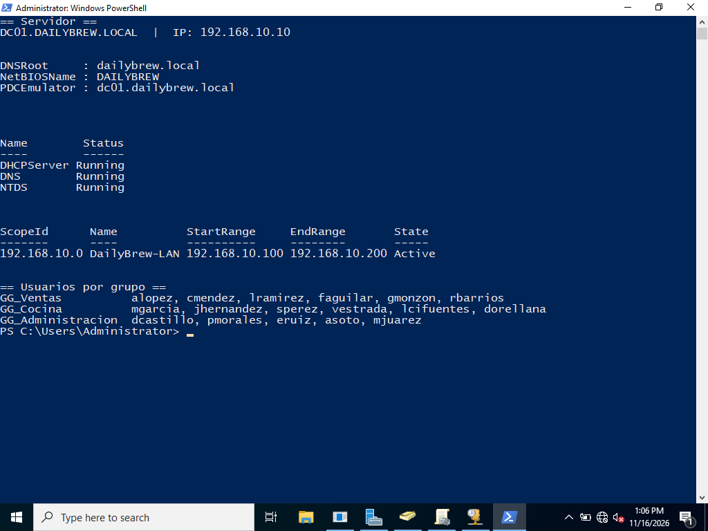
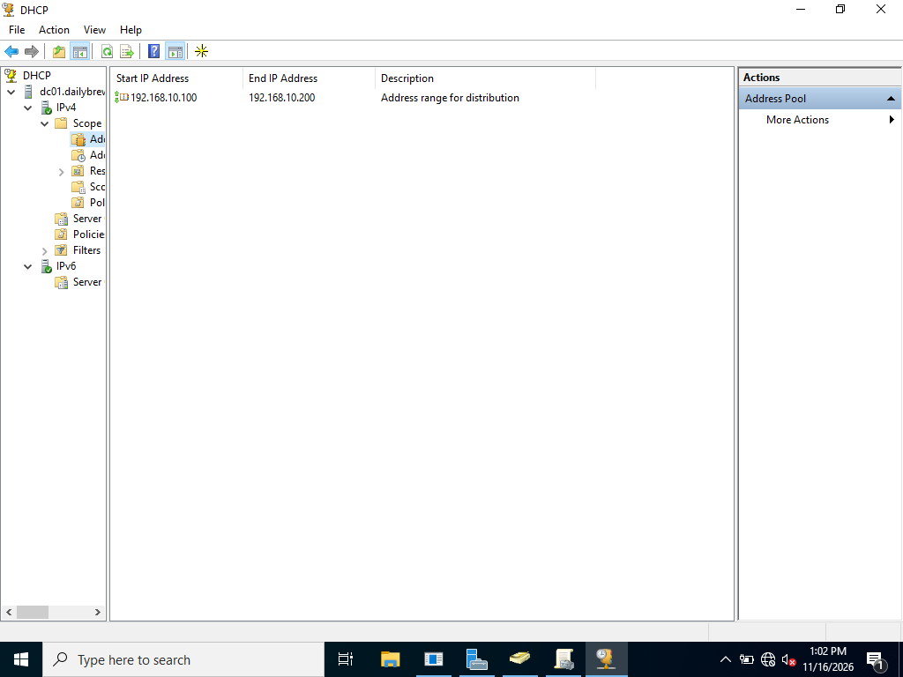
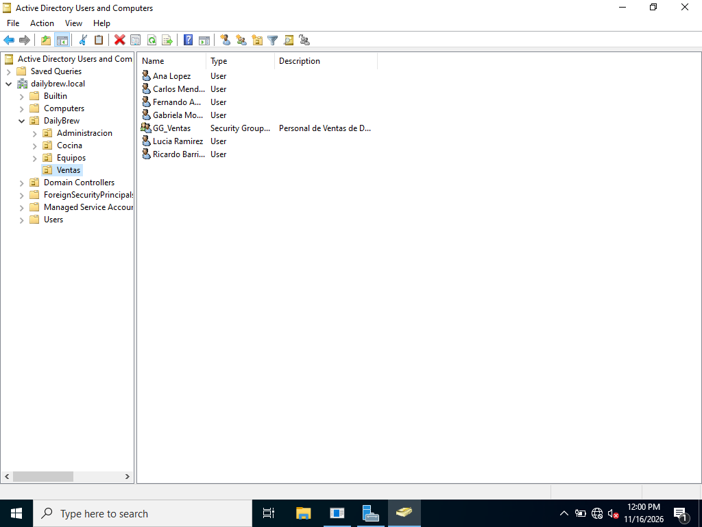
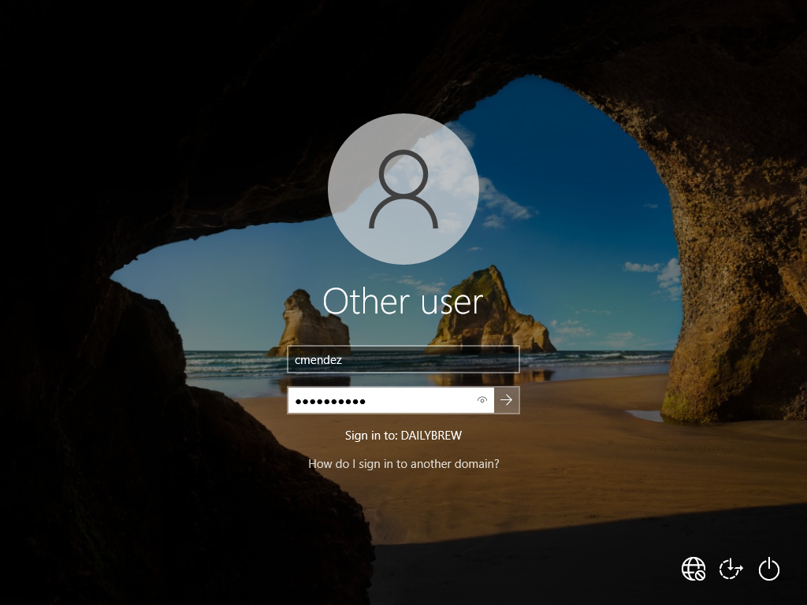
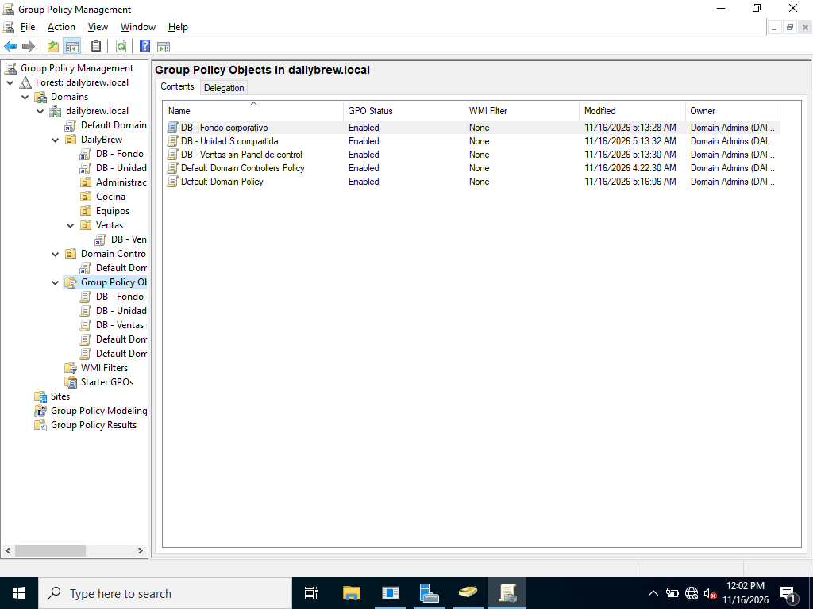
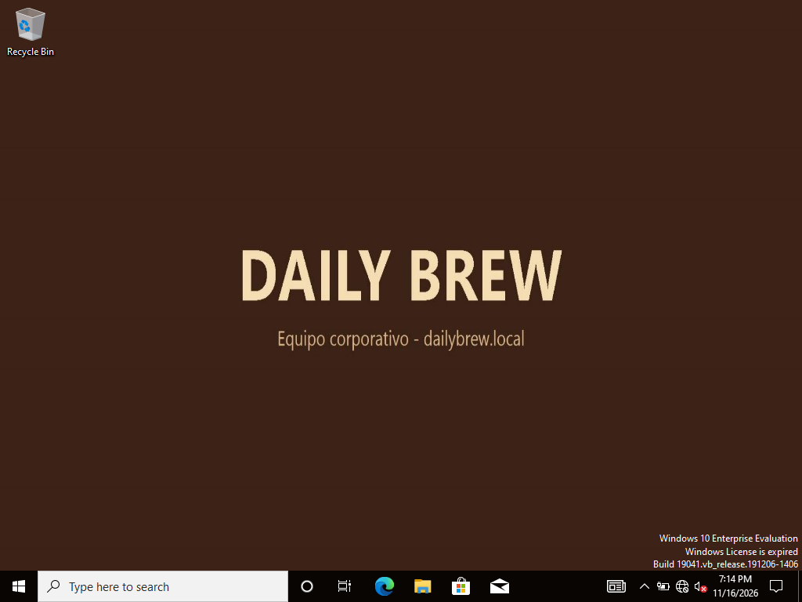
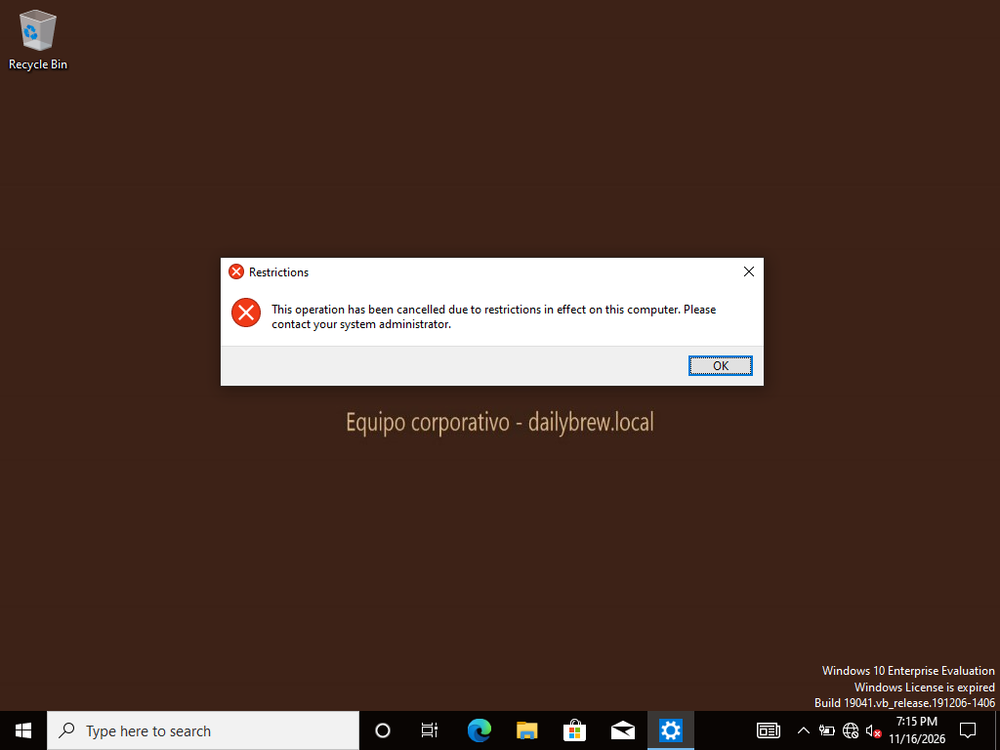
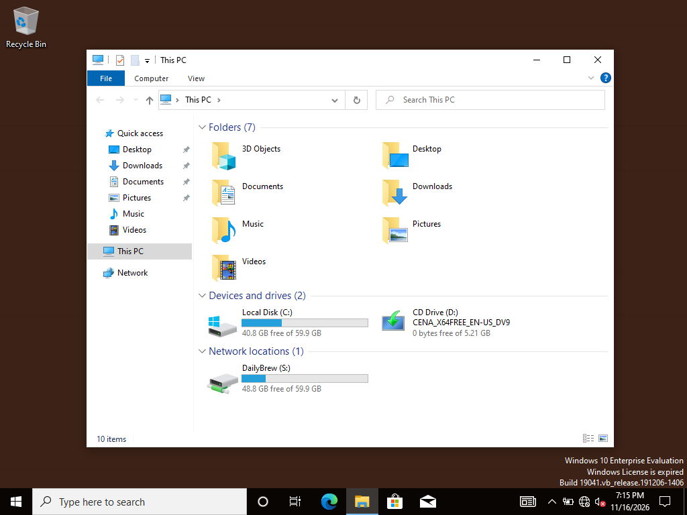
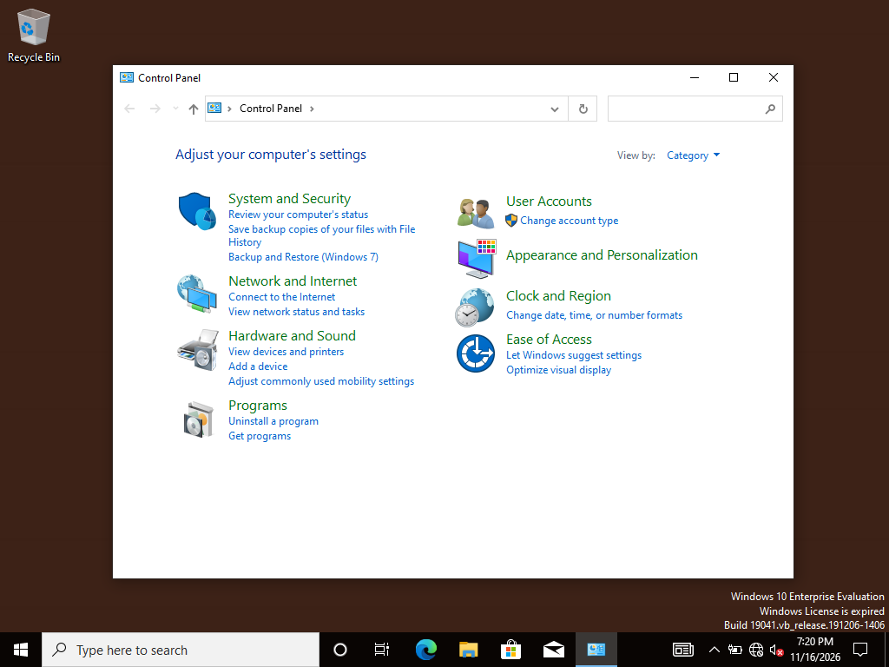

# Laboratorio de Active Directory: dominio `dailybrew.local`

Laboratorio de soporte técnico montado en VirtualBox: un controlador de dominio con Windows Server 2022 y un cliente Windows 10 Enterprise unidos en una red interna. Simula la red de una cafetería (Daily Brew) con tres departamentos.

| Elemento | Valor |
|---|---|
| Hipervisor | VirtualBox 7.2.22 |
| Servidor | `DC01`, Windows Server 2022 Standard Evaluation, IP fija `192.168.10.10/24` |
| Cliente | `CLIENTE01`, Windows 10 Enterprise Evaluation 22H2, IP por DHCP |
| Dominio | `dailybrew.local` (NetBIOS `DAILYBREW`) |
| Red | Red interna de VirtualBox `labnet`, sin salida a internet |
| Roles | AD DS, DNS, DHCP (ámbito `192.168.10.100` a `192.168.10.200`) |

Toda la configuración se hizo con los scripts de PowerShell de la carpeta [`scripts/`](scripts), ejecutados en orden. Las contraseñas que aparecen en ellos son de laboratorio y no se usan en ningún otro lugar.

## Paso 1. Máquinas virtuales

Dos máquinas en la misma red interna (`labnet`), cada una con 2 procesadores, 3 GB de RAM y disco de 60 GB. Windows se instaló de forma desatendida con `VBoxManage unattended install`.

## Paso 2. IP fija, AD DS, DNS y DHCP

- [`01-red-y-roles.ps1`](scripts/01-red-y-roles.ps1): IP fija e instalación de los roles.
- [`02-promover-dc.ps1`](scripts/02-promover-dc.ps1): promoción a controlador de dominio de un bosque nuevo.
- [`03-dhcp.ps1`](scripts/03-dhcp.ps1): autorización del DHCP en el dominio y creación del ámbito.





## Paso 3. Unidades organizativas, usuarios y grupos

[`04-ous-usuarios-grupos.ps1`](scripts/04-ous-usuarios-grupos.ps1) crea la OU `DailyBrew` con las sub-OU `Ventas`, `Cocina`, `Administracion` y `Equipos`, los grupos `GG_Ventas`, `GG_Cocina` y `GG_Administracion`, y 10 usuarios repartidos entre los tres departamentos.



## Paso 4. Cliente unido al dominio

[`08-unir-cliente.ps1`](scripts/08-unir-cliente.ps1) comprueba que el cliente recibió IP y DNS del servidor, lo une al dominio dentro de la OU `Equipos` y lo reinicia. Después se inició sesión con `cmendez`, un usuario del dominio.

```
IPv4Address : 192.168.10.100          (entregada por el DHCP de DC01)
dailybrew.local -> 192.168.10.10
CN=CLIENTE01,OU=Equipos,OU=DailyBrew,DC=dailybrew,DC=local
```



## Paso 5. Políticas de grupo

[`05-gpos.ps1`](scripts/05-gpos.ps1) crea la carpeta compartida `\\dc01\Compartido` y tres GPO:

| GPO | Vinculada a | Qué hace |
|---|---|---|
| DB - Fondo corporativo | OU `DailyBrew` | Fondo de pantalla publicado en `NETLOGON` |
| DB - Ventas sin Panel de control | OU `Ventas` | Bloquea el Panel de control solo a Ventas |
| DB - Unidad S compartida | OU `DailyBrew` | Mapea `S:` a la carpeta compartida |



Comprobación en el cliente con `cmendez` (Ventas):







Comprobación inversa con `mgarcia` (Cocina): la GPO de Ventas no le aplica y el Panel de control abre con normalidad.



Salida de [`09-verificar-gpo-cliente.ps1`](scripts/09-verificar-gpo-cliente.ps1) con `cmendez`:

```r
Applied Group Policy Objects
    DB - Ventas sin Panel de control
    DB - Fondo corporativo
    DB - Unidad S compartida
Wallpaper      : \\dailybrew.local\NETLOGON\dailybrew-fondo.jpg
NoControlPanel : 1
S:             : \\dc01.dailybrew.local\Compartido
```

## Paso 6. Tareas diarias de soporte

[`06-practica-soporte.ps1`](scripts/06-practica-soporte.ps1) practica las tres tareas más comunes de una mesa de ayuda. Salida real:

```
=== 1. RESETEAR CONTRASENA (alopez olvido su clave) ===
SamAccountName   : alopez
DebeCambiarClave : True
=== 2. DESBLOQUEAR CUENTA (jhernandez fallo la clave 3 veces) ===
Antes:   LockedOut = True
Despues: LockedOut = False
=== 3. MOVER DE GRUPO (dcastillo pasa de Ventas a Administracion) ===
Antes:   Domain Users, GG_Ventas
Despues: Domain Users, GG_Administracion
Nueva ubicacion: CN=Diego Castillo,OU=Administracion,OU=DailyBrew,DC=dailybrew,DC=local
```

| Tarea | Comando |
|---|---|
| Resetear contraseña | `Set-ADAccountPassword -Reset` y `Set-ADUser -ChangePasswordAtLogon $true` |
| Ver cuentas bloqueadas | `Search-ADAccount -LockedOut` |
| Desbloquear cuenta | `Unlock-ADAccount` |
| Cambiar de grupo | `Remove-ADGroupMember` y `Add-ADGroupMember` |
| Mover de OU | `Move-ADObject` |

## Paso 7. Alta masiva de usuarios desde CSV

[`07-crear-usuarios-csv.ps1`](scripts/07-crear-usuarios-csv.ps1) lee [`usuarios.csv`](scripts/usuarios.csv), crea cada usuario en la OU de su departamento, lo agrega a su grupo y lo obliga a cambiar la contraseña en el primer inicio de sesión. Admite `-WhatIf` para simular, omite los usuarios que ya existen y reporta las filas con error sin detenerse.

```
Usuario    Departamento   Estado
-------    ------------   ------
faguilar   Ventas         Creado
gmonzon    Ventas         Creado
rbarrios   Ventas         Creado
vestrada   Cocina         Creado
lcifuentes Cocina         Creado
dorellana  Cocina         Creado
mjuarez    Administracion Creado
precinos   Administracion Creado
alopez     Ventas         Omitido (ya existe)
hsalazar   Bodega         ERROR: No existe la OU Bodega
Creados: 8 | Omitidos: 1 | Errores: 1
```

Las dos últimas filas del CSV están puestas a propósito para probar el manejo de duplicados y de errores.

## Problemas encontrados y cómo se resolvieron

| Problema | Causa | Solución |
|---|---|---|
| "Windows cannot find the Microsoft Software License Terms" al instalar | La instalación desatendida de VirtualBox deja una clave de producto vacía, incompatible con las ISO de evaluación | Quitar el bloque `<ProductKey>` del `autounattend.xml` generado |
| Las máquinas se congelaban al correr las dos a la vez | Windows 11 tenía activo su propio hipervisor (seguridad basada en virtualización), y VirtualBox funcionaba encima en modo lento | Desactivar temporalmente VBS y el hipervisor para que VirtualBox use VT-x directamente |
| `Add-Computer` devolvía "Access is denied" | El script corría sin elevación (UAC) en el cliente | Ejecutarlo en una consola de PowerShell como administrador |
| Los comandos remotos de PowerShell no devolvían salida | PowerShell se quedaba esperando la entrada estándar | Lanzarlo con `-NonInteractive` y `< NUL` |
